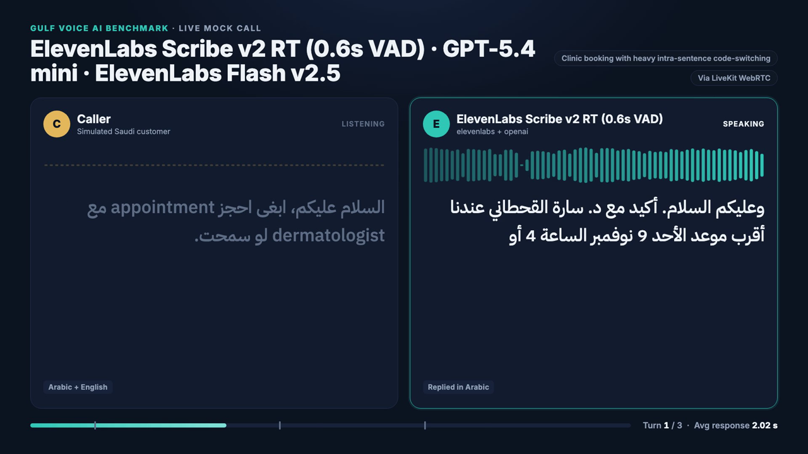

# Gulf Voice AI Benchmark

An independent benchmark of voice AI on Gulf Arabic customer calls. A simulated Saudi customer places real calls
to each system, switching between Gulf Arabic, formal Arabic (MSA) and English, often mid-sentence, the way people
in the region actually talk. Every call is scored from its recording and turned into a captioned video.



It is built for **Gulf businesses choosing a voice AI vendor** for their customer calls: every system gets the same
callers, the same business instructions and the same scoring, so the results compare like for like.

## How a test call works

1. **The caller.** Each scenario is a scripted customer call. The caller's lines are rendered once in an Arabic
   ElevenLabs voice and cached, so every system hears exactly the same audio. (`--mode dynamic` instead lets an LLM
   play the caller from each turn's intent: more realistic, less reproducible.)
2. **The call.** The caller joins a real-time call over LiveKit and talks to the system under test:
   - our own agent, built from a provider's speech-to-text, LLM and text-to-speech (one part swapped at a time), or
     a speech-to-speech model, over WebRTC;
   - or a hosted voice agent (Maqsam, Nabrah, Vapi, Retell...), called at its SIP address or phone number.
3. **Scoring from the recording.** Response times are measured on the audio itself; the reply language is judged
   from what the caller heard; an LLM judge reads the transcript against the business facts the agent was given.
4. **Outputs.** A report per call, a captioned call video (Arabic right-to-left, live waveforms, a response-time
   stopwatch), comparison charts and a comparison video of each system answering the same caller lines.

## What's measured

**Caller score /100**, the headline. It only uses what the caller experiences, so a black-box hosted agent and a
pipeline we assembled ourselves are scored the same way:

| Part | Weight | How |
|---|---|---|
| Speed | 25% | median response time (end of the caller's speech to the agent's first audio): full marks at 0.7 s or faster, zero at 3 s or slower |
| Language | 20% | share of turns answered in the language the caller expects |
| Quality | 25% | LLM judge, 0-10: understood the caller, correct against the business facts, natural for the dialect |
| Task | 20% | LLM judge: did the call get the customer what they called for |
| Reliability | 10% | minus 25 points per unanswered turn, error or turn the call never reached |

Each call also reports the slow end of response time (90th percentile) and the network round trip. For our own
pipelines it adds speech-to-text error against the caller's script and text-to-speech intelligibility.

## The test calls

The businesses and customers are fictional. `bench brief <scenario>` prints the agent's instructions (the business
facts and rules) to paste into a hosted platform; the caller's lines are never shared with the system under test.

| Scenario | The call | What it tests |
|---|---|---|
| `clinic_booking_codeswitch` | Khalid books a dermatology appointment at a Riyadh clinic | heavy Arabic-English code-switching inside sentences, insurance and fee questions, reading the booking back |
| `telecom_billing_gulf` | Fahad disputes a roaming charge on his mobile bill | Gulf Arabic with switches to English, a barge-in, explaining a bill and offering only the allowed credit |
| `bank_card_msa` | Noura asks why her credit card was declined | formal MSA and English, identity verification first, a barge-in, not inventing bank policy |

Each turn is tagged with its language (`en`, `ar-gulf`, `ar-msa`, `mixed`) and the language the reply should be in.

## What can be tested

`providers.yaml` lists 44 providers (22 Gulf and regional, 22 global): what each offers for Gulf Arabic, how it is
reached and which stacks test it. `docs/providers-research.md` has the research and sources; vendor claims are
unverified until benchmarked.

| The provider offers | How it's tested | What it needs |
|---|---|---|
| speech-to-text, text-to-speech, an LLM or speech-to-speech, with a LiveKit plugin | swapped into the reference pipeline, everything else held constant | its API key |
| an OpenAI-compatible API (Fanar, Sarj, Gulf LLMs) | the `openai` plugin pointed at its `base_url` | its API key |
| a hosted voice-agent platform | called as a black box at its SIP address or phone number | an agent set up with `bench brief`, and its address or number |
| a WebSocket or web API only | a small adapter (`bench/adapters/`) or bridge (`bench/bridges/`) | the adapter |

The stacks in `stacks/` (83 so far) come in families, so each comparison changes one thing:

| Family | What varies | Held constant |
|---|---|---|
| `ref-pipeline` | the control: ElevenLabs Scribe v2 Realtime · GPT-5.4 mini · ElevenLabs Flash v2.5 | |
| `stt-*` | speech-to-text (HUMAIN, Munsit, Nabrah, Sarj, Fanar, Speechmatics, Soniox, Deepgram, Azure, Google, AWS...) | reference LLM and voice |
| `tts-*` | text-to-speech (HUMAIN, Munsit/Faseeh, Sarj, Fanar, CAMB.AI, Azure Gulf voices, Polly, Cartesia, ElevenLabs...) | reference STT and LLM |
| `llm-*` | the LLM (Fanar, GPT-5.5, Gemini, Claude, and ALLaM, Jais, Falcon, Fanar run locally) | reference STT and voice |
| `full-*` | a vendor's own speech in and out (HUMAIN, Munsit, Sarj, Fanar) | reference LLM |
| `s2s-*` | speech-to-speech models (OpenAI Realtime, Gemini Live, xAI Grok Voice) | |
| `agent-*` | hosted voice agents (15 platforms) | |
| `local-all_*` | the LLM, with all speech on one Mac (Whisper + system voices) | local STT and voice |

### Gulf providers covered

| Provider | Based in | Tested here as | Stacks |
|---|---|---|---|
| Munsit + Faseeh (CNTXT AI) | Abu Dhabi | STT; TTS with Najdi and Emirati voices | `stt-munsit`, `tts-munsit-*`, `full-munsit` |
| Nabrah | Riyadh | STT; hosted voice agent | `stt-nabrah`, `agent-nabrah` |
| Sarj | Riyadh | STT, TTS (OpenAI-compatible) | `stt-sarj`, `tts-sarj`, `full-sarj` |
| Fanar (QCRI) | Doha | LLM, STT, TTS; open 9B model locally | `full-fanar`, `llm-fanar`, `stt-fanar`, `tts-fanar` |
| HUMAIN | Riyadh | Voice STT and TTS; ALLaM 7B locally | `stt-humain`, `tts-humain`, `full-humain`, `llm-allam-7b-local` |
| CAMB.AI | Dubai | TTS (MARS) | `tts-cambai` |
| MBZUAI IFM (Jais 3) | Abu Dhabi | Jais 3 7B locally | `llm-jais-3-7b-local` |
| TII (Falcon) | Abu Dhabi | Falcon-H1 7B, Falcon 3 7B locally | `llm-falcon-*` |
| Maqsam, Hamsa, Unifonic, Hams.AI, Dayl, ZIWO, Wittify, Sawt, Arabic.AI | Saudi Arabia, UAE | hosted voice agent | `agent-*` |

## Fair comparisons

Published comparisons follow these rules:

- Same scenarios, same caller audio, same network path from the test machine to each provider. The chart names
  where the calls were placed from.
- Like with like: WebRTC pipelines with WebRTC pipelines, phone-reached agents with phone-reached agents (the phone
  network adds about 0.3-0.6 s and narrowband audio), SIP-reached agents with SIP-reached agents, local models with
  local models.
- One judge for a whole comparison, and a strong hosted judge for anything published.
- At least three calls (every scenario) per system before it is ranked.
- Hosted platforms get the brief as written and their default Arabic voice and model; any change is noted.
- Open models run locally are quantised on a laptop and labelled as such, never presented as the vendor's hosted
  quality or speed.
- Vendors can see their own results before publication.

## Status

- Working end to end: live calls, scoring, call videos, charts and comparison videos.
- First runs (November 2026): a pilot of hosted pipelines and speech-to-speech models, and the Gulf open models
  (ALLaM 7B, Fanar 1 9B, Falcon-H1 7B, Falcon 3 7B, Jais 3 7B) against Qwen3 8B on a Mac. Rankings will be
  published once every system has its full set of calls and has been re-judged with a hosted judge.
- Next: hosted voice agents, then Arabic speech-to-text.

Vendors who would like to be included can open an issue.

## Running it

Needs Python 3.12, ffmpeg and a LiveKit Cloud project. An ElevenLabs key gives the caller its voice (scripted lines
are cached after the first render). Ollama provides a free local judge and the local open models. On Apple silicon,
`bench/localspeech.py` adds free local speech-to-text (Whisper) and text-to-speech (system voices), so a full call
can run with no provider keys at all. Calls to phone numbers need a SIP trunk (`scripts/setup_sip.py`, Twilio).

```bash
scripts/setup.sh                                  # environment, plugins, headless Chromium, local judge
.venv/bin/python -m bench doctor                  # which keys, models and stacks are ready
.venv/bin/python -m bench providers --group domestic
.venv/bin/python -m bench run -s local-all_whisper_qwen3-8b_macvoice -c clinic_booking_codeswitch
.venv/bin/python -m bench video latest --format square --turns 0-1
.venv/bin/python -m bench charts --name first-look
```

Keys go in `.env` (template: `.env.example`). To test a provider that already has a stack, add its key and run
`bench run -s <stack> -c all` (about 4-5 minutes per call). For one that doesn't, `bench new <stt|tts|llm|s2s|agent>
<name> --plugin ... --model ...` writes the stack with everything else held at the reference; `stacks/README.md`
documents the format. Other commands: `bench list`, `bench brief`, `bench rejudge`, `bench montage`, `bench report`,
`bench serve`.

## Layout

| Path | What's there |
|---|---|
| `bench/` | the caller, the agent under test, scoring, judge, videos, charts (`python -m bench`) |
| `scenarios/` | the scripted calls and the agents' business instructions |
| `stacks/` | one YAML file per system under test |
| `providers.yaml` | the provider registry |
| `docs/` | provider research, comparison plan, vendor pilot request |
| `scripts/` | setup and the SIP trunk for phone tests |
| `CLAUDE.md` | the operating runbook used with Claude Code |

Outputs (recordings, reports, videos, charts) are written to `results/`, which is not part of the repo.
